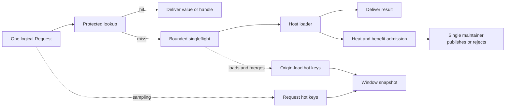
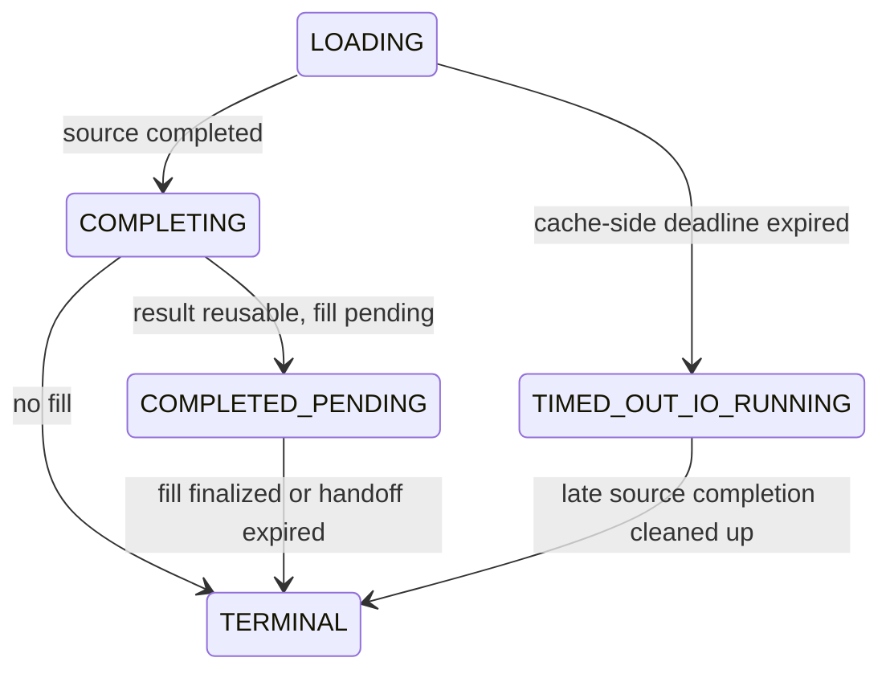

# Architecture

[中文](ARCHITECTURE.zh.md) | **English**

[Usage guide](docs/USAGE.md) · [Hot-key statistics](docs/OBSERVABILITY.md) · [Source route](docs/WALKTHROUGH.md) · [Validation and performance](docs/VALIDATION.md)

## Core design for high performance

Start here; each mechanism is detailed in the sections below. The request path does only four things: pin a protection slot, probe the index, validate the TTL, and update one heat word. Candidate preparation, maintenance, and reclamation all happen on the shard maintainer or the background executor.

| Mechanism | Approach | What it buys | Boundary and cost |
| --- | --- | --- | --- |
| Sharding with a single writer | Keys hash into shards with a random seed and the namespace participates in identity; only the maintainer mutates the index, the SIEVE chain, the timing wheel, and the accounting | Reads take no write lock and never wait for the maintainer; scaling follows the shard count | Per-shard quota must balance the global free pool; `ShardCount` defaults to 16, rounds up to a power of two, and is fixed after construction |
| Fixed entry pool + epoch reclamation | Readers pin an epoch slot; the maintainer unlinks and records the retirement epoch; slots return to the pool after two generations | Resident memory is reused, avoiding GC scanning and heap growth | Insufficient protection slots or retirement budget return `ErrBusy` / `ErrOverloaded` |
| Stack-allocated `Request` and borrowed views | `Request` does not escape; a borrowed view is 32B and an owned handle 48B; `BorrowOn` reuses caller storage | Steady-state hits cost 0 B/op and 0 allocs/op | A borrowed view cannot outlive its scope; an owned handle must be `Release`d |
| Single-word atomic heat | `{epoch, current, previous}` packed into one 64-bit atomic word, with bucket advance and increment committed by one CAS | Counting is lock-free and never exposes a new bucket before clearing the old counts | 12-bit saturation undercounts; gate collisions overcount |
| Bounded `TryLock` + drop counters | Observation tables and striped locks only attempt to lock | Slow paths and contention never affect delivery latency | Events are dropped and must be identified through the quality fields |
| Bounded singleflight + bounded completion pump | At most one real loader per identity, the loader runs outside locks, and results reach the pump through a one-shot mailbox | Duplicate origin loads are merged, locks are held briefly, and the business result is still delivered when the queue is full | A full queue guarantees delivery only, not filling |
| Bounded replacement | No victim search while capacity suffices; otherwise the SIEVE hand scans and enumerates subsets of at most 8 candidates | Replacement cost has an upper bound and never searches globally | Global optimal replacement is not guaranteed |
| Off-path maintenance | Sample stripes, sketch folding, even/odd window double buffering, fair rotation by category quota with a soft time budget | Statistics and compaction never sit on the request path | Maintenance lag causes missing windows, `Partial`, or `Skipped` |
| Read-time TTL + timing wheel | Every read checks the hard TTL against a monotonic clock and the background wheel removes entries within budget | Maintenance lag never turns an expired value into a hit | About a third of hit cost is the clock read; with `DisableTicker` the host must drive `MaintenanceStep` |

Together these reduce a hit to "hash to a shard, one index probe, one clock read, one atomic count". Benchmark and load-test numbers appear only in [Validation and performance](docs/VALIDATION.md) and are not copied here, so that repository self-measurements are not presented as cross-hardware or end-to-end guarantees.

## Data flow

Each key lands in one shard by hash with a random seed, and the namespace participates in identity. Readers access a fixed probe index; each shard has exactly one maintainer that mutates the index, the SIEVE chain, the timing wheel, and the residency accounting. The request path never waits for the maintainer to finish.

Caching and hot-key statistics share the request entry point; the statistics switches do not change admission or delivery semantics. `ObserveOnly` rejects residency before a fill candidate is even prepared, which removes the entry pool and the capacity-scaled index while keeping request heat, optional rankings, load merging, and size validation. Existing business code can call only `Get` to record requests without making the SDK load from origin.

## Request heat and benefit are two separate statistics

**Heat decides whether a key is hot enough.** Each heat cell stores the current bucket, the previous bucket, and the bucket number in one atomic word:

`H(t) = current + (1 - φ) × previous`

Misses are recorded in a fixed-size Count-Min gate, hits in the resident entry. The same `Request` records only once, and `Heat` queries the sum of both. Collisions overestimate, saturation and bounded CAS retries underestimate. `Tin` controls entry and `Tout < Tin` controls exit; new entries are protected by `Grace`, and entries are cooled out only after staying continuously low-heat for `ColdFor`.

**Benefit decides whether a key is worth capacity.** Requests enter a striped buffer with probability `SampleP`, and the maintainer folds samples carrying their original sampling probability into a second double-bucket sketch. Estimates fall into one of:

| State | Condition |
| --- | --- |
| MEASURED | Statistical warm-up is complete and valid samples reach `NMin` |
| PRIOR | No measurement yet, so an unexpired namespace prior is used |
| UNAVAILABLE | Missing prior, samples lost or too old, invalid model, etc.; filling is deferred |

Expected benefit is `(avoidable load rate × single cost - ongoing service cost) × min(HorizonW, remaining TTL)`. The default model targets hit count; the cost model needs a merge-rate calibration from the host and must not treat request rate as the real load rate. One decision freezes time, prior, model identity, version, and unit so that cross-model comparisons cannot be distorted.

## Admission and replacement

A successful load delivers the business result first and only then attempts to create a fill candidate. The candidate must satisfy the hard deadline, generation, heat, size, handoff budget, and pool slot constraints; `ObserveOnly` stops here.

When capacity suffices there is no victim search. When capacity is insufficient, the maintainer scans a bounded number of entries along the SIEVE hand, skips recently accessed entries, and enumerates feasible subsets from at most 8 candidates. Feasibility considers entry count, bytes, retirement budget, index position, and the timing wheel. After choosing the subset with the smallest loss, the maintainer deducts install and removal cost and commits only when net benefit is positive.

"Exact" here is limited to the collected local candidate set; there is no guarantee of a globally optimal replacement across the whole cache.

Candidate state is `QUEUED → COMMITTING → TERMINAL`. Retirement responsibility is reserved and identity re-checked before the irreversible point; afterwards the single maintainer performs removal, installation, and terminal settlement without calling host code again.

## Origin-load merging and cancellation

Merge identity is `(namespace, full key, namespace generation, shard fillFence)`. Striped locks use only bounded `TryLock`, so at most one real loader exists per identity. Waiters, real I/O, response bytes, and executor tasks are each quota-limited.

Key flight states:

The loader runs outside internal locks, and results pass to a bounded completion pump through a one-shot mailbox; when the queue is full the business result can still be delivered. `COMPLETED_PENDING` allows reusing an already completed result without loading from origin again.

Cancellation settles only the caller's own Future. After a cache-side load timeout the responsibility for the real I/O remains; late results are not used for filling, and I/O quota is returned only after the source truly finishes. The library cannot force a database or RPC call to stop.

## TTL, invalidation, and safe reclamation

The hard TTL is checked on every read, and the background timing wheel removes entries within budget. Maintenance lag never lets an expired value continue to hit. Cooldown scans and TTL removal proceed independently.

Single-key invalidation is confirmed by the shard maintainer, which advances the shard `fillFence` so that in-flight fills holding older tokens in the same shard are voided; business results for other keys can still be delivered. Namespace invalidation advances the generation first, so the old generation is logically hidden immediately, and then removes entries in batches. Confirmation guarantees only logical invalidation and does not wait for physical release.

The fixed pool reuses entries, so the Go GC cannot replace reader protection:

1. A reader pins an epoch protection slot first, then reads the index and the entry; it unpins when the scope ends.
2. An owned handle acquires its own pin inside the guard, which allows holding it across goroutines.
3. The maintainer marks the entry unreadable, unlinks it, and records the retirement epoch.
4. Once the epoch has advanced at least two generations and owned pins are cleared, the executor drops references and returns the pool slot and retirement budget.

Insufficient protection slots, handles, or budget return `ErrBusy` / `ErrOverloaded`; the limits are never bypassed with unbounded allocation. After a plain Go value is returned, retention responsibility passes to the caller; a shallow copy does not change the sharing relationship of the underlying storage.

## Resources and maintenance

Entry counts and resident bytes come from per-shard quota plus a global free pool, with in-transit transfers accounted separately:

`Σ shard quota + global free quota + in-transit quota = total quota`

Handoffs, responses, retirement, loads, waiters, and handles each reserve credits. Every credit can be returned or transferred exactly once, and a budget return cannot precede the actual reference release. `MemoryLimits` aggregates fixed structures, bounded auxiliary state, and classified byte quotas; it depends on the Weigher and host model size contract and does not cover host temporary space, executor storage, GC garbage, or RSS.

Maintenance rotates fairly by category quota, covering samples, control, fills, the timing wheel, cooldown, and retirement reclamation; each round also has a soft time budget. A ticker drives maintenance when idle by default. With `DisableTicker` the host must call `MaintenanceStep` periodically, including during shutdown.

Shutdown has three stages: stop accepting work with `Shutdown`; wait for accepted work to finish with `WaitDrained`; wait for readers, handles, retirement, and budget to clear with `WaitReclaimed`. `Close` stops accepting and waits for safe reclamation; an expired context returns an incomplete error while existing cleanup responsibility continues.

## Hot-key windows

### Two tables, two different measurements

| Ranking | Counting point | Counts cache hits | Sampling | Enabling and reading |
| --- | --- | --- | --- | --- |
| Request hot keys | One successful `BeginRequest`; both `Get` and `Fetch` count, no loader required | Yes, including `Get`-only traffic | Sampled at `ObserveRequestSampleP`, default 1/1024; readings are scaled by `1/q` | `ObserveRequestKeys > 0` plus history or notification; only in the window snapshot `Requests`, no instant interface |
| Origin-load hot keys | Real loader invocations and merged waiters | No | Every event, never resampled | `ObserveHotKeys > 0`; observe-only mode defaults to 128 per shard, negative disables; instant `HotKeys(n)` and window `Top` |

The two rankings are not interchangeable: a key on both means it is hot yet still not absorbed by the cache (insufficient capacity, short TTL, evicted, or not cacheable), while a key only on the request ranking has a high absorption rate. The request ranking serves capacity and key-cardinality planning; the origin-load ranking attributes backend pressure and judges the payoff of more cache. Observe-only mode has no loader, so the origin-load ranking is empty.

Both tables have fixed slots, writes use `TryLock`, and a failure only increments a drop counter; a request never blocks waiting for the observation lock.

History windows are independent of the admission heat window. Windows are buffered in an even/odd double buffer, and Space-Saving inheritance error is used when slots are full; maintenance collects in batches, publishes a bounded ranking, and appends it to a fixed history ring. Late events cannot rewrite an already published window; maintenance lag produces `Skipped`, `Partial`, or lost counts.

Exports copy rankings for the caller, so neither callbacks nor readers pollute internal history. `HotKeyLabel` runs outside the maintenance thread; `OnHotWindow` is serialized and may drop notifications, so it is recommended to only signal there and then read history with the `HotWindowsSince` cursor. Accuracy and quality fields are described in [Hot-key statistics](docs/OBSERVABILITY.md).
