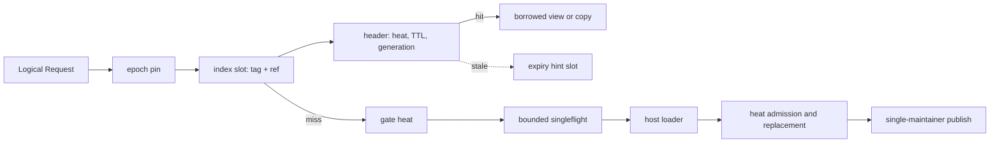

# Architecture

[中文](ARCHITECTURE.zh.md) | **English**

[Usage](docs/USAGE.md) · [Hot-key statistics](docs/OBSERVABILITY.md) · [Source walkthrough](docs/WALKTHROUGH.md) · [Validation](docs/VALIDATION.md)

## Design principles

1. **Reserve once, release lazily.** `New*` derives every structure size from the config and reserves the entry region, index region and side table once; nothing grows at run time. Physical pages are only committed on first write, a retired entry's space returns to the allocator's free lists for reuse, and everything is returned when the instance closes.
2. **Resident data holds no pointers.** Entry headers, keys, values and index slots live in the reserved region and contain no Go pointers, so the GC never scans them. The Go heap keeps only fixed-size structures that do not depend on the entry count.
3. **Explicit types.** How a value is stored is chosen by the constructor: `NewBytes`, `NewFlat`, `NewObject`. There is no reflection at run time, only a small enum `switch`.
4. **Lazy retirement.** Every read validates the TTL and the invalidation generation, so an expired value is never delivered. Expired entries are retired when they are accessed, reached by the eviction scan, or reached by the slow sweep; there is no per-entry timer.
5. **One writer per shard.** A single maintainer per shard allocates, publishes, evicts and frees; readers only pin and read.
6. **Lossy observation.** Statistics paths use `TryLock` and only count failures; they never block a request.

## Storage model

| Constructor | Value type | Block contents | Read | Billing |
| --- | --- | --- | --- | --- |
| `NewBytes[V ~string \| ~[]byte]` | strings, byte slices | raw bytes of the content | borrowed view is zero-copy; `Get` copies once | block size |
| `NewFlat[V]` | pointer-free fixed-size types (numbers, arrays, pointer-free structs) | memory image of `V`, 8-byte aligned | value copy, zero allocations | block size |
| `NewObject[V]` | any type | header and key only; the value stays in a per-shard side table `[]V` | value copy, zero allocations | caller's `weigh` |

`NewFlat` verifies once, at construction, that the type holds no pointers, and never uses reflection afterwards. Objects containing maps, interfaces or pointers outside the block cannot be copied safely into pointer-free memory: the GC would not trace the pointers inside and could collect the referents early. Such values must use `NewObject`, where the GC scans them.

Each shard owns one contiguous region:

- On 64-bit linux without `-race` the region is an anonymous `mmap`, which does not count toward the GOGC trigger; other platforms and `-race` builds put it on the Go heap (keeping race and `checkptr` coverage). `Memory.Heap` forces the heap, `Memory.HugePages` suggests transparent huge pages, and `Memory.Prefault` pre-touches the index region at creation.
- A TLSF allocator (boundary tags plus segregated free lists) manages the region: allocation and free are O(1) and free blocks coalesce with their neighbours. A block reference is a 32-bit offset in 8-byte units, so a shard region is at most 32 GiB.
- A block is `[88-byte header][key padded to 8][value]`. The header holds identity, deadline, the heat word, the pin count and the SIEVE and retire links, all fixed-width integers.
- An index slot is 64 bits: the high 32 bits are a keyHash tag, the low 32 bits a block reference. The tag is compared before the header is read.

The resident-memory bound is `MemoryLimits.RegionBytes`: the byte quota times `1 + Memory.SlackPercent` (default 15%, covering fragmentation and retired blocks not yet reclaimed), plus one maximum-size entry. When the slack is exhausted a fill is rejected gracefully with `ALLOCATION_FAILED` and the business result is still delivered.

## Request path

A borrowed hit costs a pin, one index probe, the cache line holding the header and key, one clock read and one atomic heat update, with zero allocations. `Get` copies once for string-like types because blocks are reused and a string pointing into a block must not be handed to the caller; use `BorrowOn` for zero-copy reads.

## Heat, valuation and replacement

**Heat decides whether a key is hot.** Each heat cell packs the current bucket, the previous bucket and the bucket number into one atomic word: `H(t) = current + (1 - φ) × previous`. Misses are recorded in a fixed-size Count-Min gate and hits in the resident entry; `Heat` reports their sum. Collisions overestimate and saturation underestimates. `Tin` controls admission.

**Valuation is heat times cost.** Benefit `G = λ × cost × min(Horizon, remaining TTL)`, where `λ = H / Heat.Delta` and `cost` is `ResultMetadata.Cost` (default 1). A candidate uses its gate heat; a resident entry uses hit heat plus gate heat; an expired or invalidated entry has zero loss. At billion-entry scale almost no key accumulates enough sampled observations, so the sampling estimator and cost models are gone: heat is always available at the target scale, and once the cache is full a hot key reliably replaces a cold one.

**Replacement.** With enough free capacity no victim is searched. Otherwise the SIEVE hand scans a bounded range, skips recently visited entries and enumerates feasible subsets of at most 8 candidates exactly. A fill commits only when the net gain `G(candidate) - loss(old entry) - loss(victims)` is positive. Feasibility accounts for entry count, bytes and index position. "Exact" is relative to the locally collected candidate set, not a global optimum. A candidate moves `QUEUED → COMMITTING → TERMINAL`; physical allocation happens before the irreversible point, and a failure removes no entry.

## TTL, invalidation and safe reclamation

- **Validation on read.** `lookup` checks the readable bit, the namespace generation and the hard deadline.
- **Three retirement paths.** A reader that finds a stale entry writes its index slot number into one of the shard's 64 lossy hint slots; the maintainer swaps it out and re-validates the entry before retiring it, so a reused slot is never removed by mistake. The SIEVE scan retires stale entries it meets. The slow sweep `sweepStep` is the only cursor and handles expiry, namespace-generation invalidation and close; by default it covers the whole index every five minutes (`SweepPeriod`) and checks the soft time budget every 256 slots.
- **Single-key invalidation** is confirmed by the shard maintainer and advances the shard's `fillFence`, voiding in-flight fills of that shard that hold an older token. **Namespace invalidation** advances the generation first, so the old generation is hidden logically at once, then removes entries in batches.
- **Safe reclamation.** A removed entry is linked into the shard's intrusive retire chain. Readers pin an epoch slot before reading the index, and owned handles take their own pin inside the guard. After the epoch advances at least two generations and owned pins are gone, the maintainer returns the block to the allocator. There is no separate retirement budget: the region itself is the bound.
- **Access after close.** `RECLAIMED` requires that no pin exists, and readers re-check the state after pinning, so any reader that passes the check precedes the release of the region. Using a borrowed view after `Close` is an error; a view must be finished before `Release`.

## Source coalescing and cancellation

The coalescing identity is `(namespace, full key, namespace generation, shard fillFence)`. At most one real loader runs per identity; it runs outside internal locks and hands its result to a bounded completion pump through a one-shot mailbox, so the business result is delivered even when the queue is full. Waiters, real I/O, response bytes and executor tasks have separate limits. Cancelling settles only the caller's `Future`; after the cache-side load timeout the library still owns the real I/O, and it cannot stop a database or RPC call. When a cache hit is delivered through a `Future`, string-like values are copied out before the handle is released, so a delivered result never holds a view into a block.

## Resources and maintenance

Per-shard entry and byte quotas are fixed at creation as the fair share, with the remainder going to the first shards; there is no quota transfer between shards. With hash sharding the per-shard deviation is small at scale; a very small cache (tens of entries per shard) should lower `Shards`. Hand-off, response, load, waiter and handle budgets are reserved as receipts that can be returned or transferred exactly once.

Maintenance rotates fairly over classes (control, lifecycle, fill, reclaim) with a soft time budget per round. Fills have no rate limit; they are bounded by queue length, per-round quota and the soft budget, and admission quality is enforced by `Tin`. With `DisableTicker` the host must call `MaintenanceStep` no slower than `PeriodicInterval`. Closing has three phases: `Shutdown` stops admission, `WaitDrained` waits for accepted work to finish, `WaitReclaimed` waits for readers, handles and the retire chain to clear and releases the region.

There are three run modes (`Config.Mode`): `ModeCache` is a normal cache; `ModeShadow` is a shadow cache that stores only headers and keys, reports hits to callers as misses, and makes `Stats.Hits/Misses` virtual; `ModeObserve` only gathers statistics: the entry region shrinks to 4 KiB and the index to one group, the heat gate keeps its size, and heat, rankings and coalescing still work.

## Hot-key windows

Two tables with two meanings:

| Table | Counted at | Includes cache hits | Sampling | Enabling and reading |
| --- | --- | --- | --- | --- |
| Request hot keys | a successful `BeginRequest`; both `Get` and `Fetch` count | yes | `Hot.RequestSampleP`, default 1/1024, readings scaled by `1/q` | `Hot.RequestSlots > 0` plus history or notification; appears in the window snapshot `Requests` |
| Load hot keys | real loader calls and merged waiters | no | all events | `Hot.LoadSlots > 0`; live `HotKeys(n)` and windowed `Top` |

The two rankings do not substitute for each other: a key on both is hot and not absorbed by the cache; a key only on the request ranking is well absorbed. Both tables have fixed slots and write under `TryLock`, counting a drop on failure. When full, a new key that passes the pre-filter inherits the heap-root count as its error, so the true sampled count lies in `[rank - err, rank]`. A late event cannot rewrite a published window; maintenance lag produces `Skipped`, `Partial` or lost counts.

**Tracker structure.** The request and origin-load tables share one tracker core, and the cost of a record does not depend on the number of slots:

- **Lookup**: an open-addressing hash table kept at most half full, with linear probing and backward-shift deletion, so a lookup is O(1).
- **Eviction**: a pointer-free index min-heap keyed by (count in the current window, true count in the other window); the root is the entry with the smallest current count, and eviction is O(log k).
- **Pre-filter**: one conservative-update Count-Min per window parity, 4 rows × 4 columns in one cache line. An untracked key is admitted to a slot only when its estimate exceeds the heap root's count, and it inherits that count as its error bound, so a long tail of cold keys cannot push real hot keys out of the ranking. Invariants within a window: a tracked key's true count lies in `[rank - err, rank]`, and an untracked key's true count does not exceed the heap root's count.
- **History**: each window is stored as pointer-free columnar records plus one block of key bytes, so keeping it for a long time adds no GC scan work; `HotKeyStat` is only materialized on export.
- **Collection**: each cycle collects incrementally within a budget (16384 slots) and publishes only when done; a published window is never rewritten.

Measurements (65,536 slots, a Zipf stream over 100 million keys: about 65 ns per event and 99.7% top-10k recall) are in [Validation](docs/VALIDATION.md#hot-key-tracking). For tens of thousands of hot keys use a few hundred to a few thousand slots per shard and keep `Hot.RequestSampleP` at or below 1/16.
