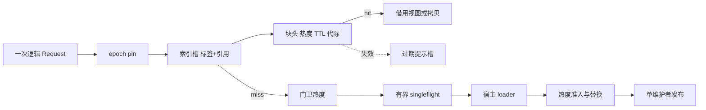

# 架构原理

**中文** | [English](ARCHITECTURE.md)

[使用指南](docs/USAGE.zh.md) · [热点统计](docs/OBSERVABILITY.zh.md) · [源码路线](docs/WALKTHROUGH.zh.md) · [验证与性能](docs/VALIDATION.zh.md)

## 设计原则

1. **一次预留，惰性释放。** `New*` 按配置算出全部结构尺寸，一次预留条目区、索引区和侧表；运行期不扩容。物理页在首次写入时才占用，条目退场后空间只回到分配器空闲表复用，实例关闭时整体归还。
2. **驻留数据零指针。** 条目头、key、值、索引槽都放在预留的内存区里，不含 Go 指针，GC 不扫描它们。Go 堆里只剩与条目数无关的固定结构。
3. **类型显式。** 值的存放方式由构造函数决定：`NewBytes`、`NewFlat`、`NewObject`。运行期没有反射，按小枚举 `switch` 分派。
4. **惰性退场。** 每次读取校验 TTL 与失效代际，过期值永不交付；过期条目在被访问、被淘汰扫描到或被慢扫描扫到时退场，没有逐条目定时器。
5. **分片单写者。** 每个分片只有一个维护者负责分配、发布、淘汰和释放；读者只做 pin 加读取。
6. **有损观测。** 统计路径一律 `TryLock`，失败只计数，不阻塞请求。

## 存储模型

| 构造函数 | 值类型 | 块内容 | 读取 | 计费 |
| --- | --- | --- | --- | --- |
| `NewBytes[V ~string \| ~[]byte]` | 字符串、字节切片 | 内容的原始字节 | 借用视图零拷贝；`Get` 拷贝一次 | 块大小 |
| `NewFlat[V]` | 无指针定长类型（数值、数组、无指针结构体） | `V` 的内存映像，8 字节对齐 | 值拷贝，零分配 | 块大小 |
| `NewObject[V]` | 任意类型 | 只有头和 key；值留在分片侧表 `[]V` | 值拷贝，零分配 | 调用方的 `weigh` |

`NewFlat` 在构造时用一次反射确认类型不含指针，之后不再反射。含 `map`、接口或块外指针的对象不能安全地拷进无指针内存：GC 不追踪里面的指针，会提前回收被引用的对象，所以这类值只能用 `NewObject`，由 GC 扫描。

每个分片一段连续内存区：

- 64 位 linux 的非 `-race` 构建用匿名 `mmap`，不计入 GOGC 触发线；其余平台与 `-race` 构建放在 Go 堆上（保留竞态与 `checkptr` 检查）。`Memory.Heap` 可强制放在堆上，`Memory.HugePages` 可建议透明大页，`Memory.Prefault` 在创建时预触碰索引区。
- 区内是 TLSF 分配器（边界标记加分级空闲表）：分配与释放都是 O(1)，释放时与相邻空闲块合并。块引用是 32 位、8 字节粒度的偏移，单分片最多 32 GiB。
- 块布局为 `[头 88B][key，补齐到 8B][值]`。头里是身份、截止时间、热度字、pin 计数、SIEVE 与退休链接，全部为定长整型。
- 索引槽是 64 位：高 32 位是 keyHash 标签，低 32 位是块引用，先比标签再读块头。

常驻内存上界是 `MemoryLimits.RegionBytes`：字节额度乘 `1 + Memory.SlackPercent`（默认 15%，同时覆盖碎片与尚未回收的退休块），再加最大条目。余量不足时填充以 `ALLOCATION_FAILED` 优雅拒绝，业务结果照常交付。

## 请求路径

一次借用命中：pin 保护槽、一次索引探测、块头与 key 所在的缓存行、一次时钟读取、一次原子热度更新，零分配。`Get` 对字节串类型多一次拷贝，因为块会被复用，不能把块内字符串直接交给调用方；需要零拷贝时用 `BorrowOn`。

## 热度、估值与替换

**热度决定是否够热。** 每个热度单元用一个原子字保存当前桶、上一桶与桶号：`H(t) = current + (1 - φ) × previous`。miss 记入固定大小的 Count-Min 门卫，hit 记入驻留条目，`Heat` 查询两者之和。碰撞会高估，饱和会低估。`Tin` 控制准入。

**估值统一为热度乘成本。** 收益 `G = λ × cost × min(Horizon, 剩余 TTL)`，其中 `λ = H / Heat.Delta`，`cost` 是 `ResultMetadata.Cost`（默认 1）。候选取门卫热度，驻留条目取命中热度加门卫热度，已过期或失效的条目损失为 0。亿级下绝大多数 key 攒不够采样样本，所以不再有采样估值和成本模型：热度在目标规模下始终可用，缓存满载后热 key 能稳定替换冷 key。

**替换。** 容量足够时不搜索受害者。不足时沿 SIEVE hand 有界扫描，跳过最近访问过的条目，从最多 8 个候选中精确枚举可行子集，要求净收益 `G(候选) - 旧条目损失 - 受害者损失` 为正才提交。可行性同时考虑条数、字节和索引位置。这里的“精确”限于已收集的局部候选集，不保证全局最优。候选状态为 `QUEUED → COMMITTING → TERMINAL`；不可逆点之前完成物理分配，失败时不移除任何条目。

## TTL、失效与安全回收

- **读时校验。** `lookup` 校验可读位、命名空间代际和硬截止时间。
- **三条退场路径。** 读者发现失效条目时往分片的 64 个有损提示槽之一写入索引槽号；维护者取出后按语义复核再退休，条目被复用也不会误删。SIEVE 扫描遇到失效条目直接退休。慢扫描 `sweepStep` 是唯一游标，处理过期、命名空间代际失效与关闭，默认 5 分钟（`SweepPeriod`）扫完整张索引，每 256 槽检查一次软时间预算。
- **单 key 失效** 由分片维护者确认并推进分片 `fillFence`，使同分片旧令牌的在途填充作废。**命名空间失效** 先推进代际，旧代际立即逻辑隐藏，再分批摘除。
- **安全回收。** 条目在被摘除时挂入分片的侵入式退休链。读者先 pin epoch 槽再读索引；拥有型句柄在 guard 内取得独立 pin。epoch 至少推进两代且拥有型 pin 清空后，维护者把块还给分配器，没有单独的退休预算，内存区本身就是上限。
- **关闭后访问。** `RECLAIMED` 要求没有任何 pin，而读者在 pin 之后复核状态，所以通过复核的读者一定先于内存区释放。`Close` 之后继续使用借用视图是错误；视图必须在 `Release` 前用完。

## 回源合并与取消

合并身份是 `(命名空间, 完整 key, 命名空间代际, 分片 fillFence)`。同身份最多一个真实 loader，loader 在内部锁之外运行，结果经一次性邮箱交给有界完成泵；队列满时仍交付业务结果。等待者、真实 I/O、响应字节和执行器任务分别限额。取消只结算自己的 `Future`；缓存加载超时后仍保留真实 I/O 的责任，库无法强制停止数据库或 RPC 调用。缓存命中经 `Future` 交付时，字节串先拷出再释放句柄，交付结果不持有指向块内的视图。

## 资源与维护

每分片的条数与字节额度在创建时固定为公平份额，余数分给前几个分片；没有分片间额度转移。哈希分片在大规模下各分片的偏差很小，极小的缓存（每分片只有几十条）应调小 `Shards`。交接、响应、加载、等待者和句柄分别预留凭证，每份凭证只能归还或转移一次。

维护按类别配额公平轮转（控制、生命周期、填充、回收），每轮另有软时间预算；填充不再有速率限制，只受队列长度、每轮配额与软时间预算约束，准入质量由 `Tin` 保证。`DisableTicker` 时宿主必须以不慢于 `PeriodicInterval` 的节奏调用 `MaintenanceStep`。关闭分三阶段：`Shutdown` 停止受理；`WaitDrained` 等待已受理工作终结；`WaitReclaimed` 等待读者、句柄和退休链清空并释放内存区。

三种运行模式（`Config.Mode`）：`ModeCache` 正常缓存；`ModeShadow` 影子缓存，只存头和 key，命中对调用方表现为未命中，`Stats.Hits/Misses` 是虚拟命中率；`ModeObserve` 仅统计，条目区只留 4 KiB、索引只留一组，热度门卫保持原尺寸，保留热度、榜单与合并。

## 热点窗口

两张表，两种口径：

| 表 | 计数点 | 含缓存命中 | 采样 | 开启与读取 |
| --- | --- | --- | --- | --- |
| 请求热点 | 一次成功 `BeginRequest`，`Get` 或 `Fetch` 均计入 | 含 | 按 `Hot.RequestSampleP` 采样，默认 1/1024，读数乘 `1/q` | `Hot.RequestSlots > 0` 且须启用历史或通知；出现在窗口快照 `Requests` |
| 回源热点 | 真实 loader 调用与合并等待者 | 不含 | 全量事件 | `Hot.LoadSlots > 0`；即时榜 `HotKeys(n)` 与窗口榜 `Top` |

两张榜不可互相替代：同一 key 同时上榜说明它够热但没被缓存挡住；只出现在请求榜说明吸收率较高。两张表都是固定槽位，写入用 `TryLock`，失败只增加丢弃计数。槽满时新 key 经前置过滤放行后继承堆根计数作为误差，真实采样数落在 `[rank - err, rank]`。迟到事件不能改写已发布窗口；维护滞后会产生 `Skipped`、`Partial` 或丢失计数。

**追踪表的结构。** 请求表与回源表共用一个追踪表核心，每次记录的成本与槽位数无关：

- **定位**：开放寻址哈希表，装载率不超过 1/2，线性探测、后移删除，查找 O(1)。
- **逐出**：无指针的下标最小堆，排序键为（当前窗口计数，另一窗口的真实计数），堆根即当前计数最小者，逐出 O(log k)。
- **前置过滤**：每个窗口奇偶各一份保守更新的 Count-Min，一条缓存行装下 4 行 × 4 列。未追踪的 key 只有估计值超过堆根计数才入槽，并继承该计数作为误差上界，所以长尾冷 key 不会把真实热点挤出榜单。窗口内的不变量：已追踪 key 的真实计数在 `[rank - err, rank]` 内，未追踪 key 的真实计数不超过堆根计数。
- **历史**：每个窗口以无指针的列式记录加一块 key 字节保存，长期保留不增加 GC 扫描量；只有导出时才物化 `HotKeyStat`。
- **采集**：每个周期按预算（16384 个槽）增量采集，采完才发布，发布后的窗口不再被改写。

实测（65536 槽、1 亿 key 的 Zipf 流量：记录约 65 ns/事件、top-1 万召回率 99.7%）见[验证与性能](docs/VALIDATION.zh.md#热点追踪)。数万量级热点建议每分片几百到几千个槽，`Hot.RequestSampleP` 不高于 1/16。
