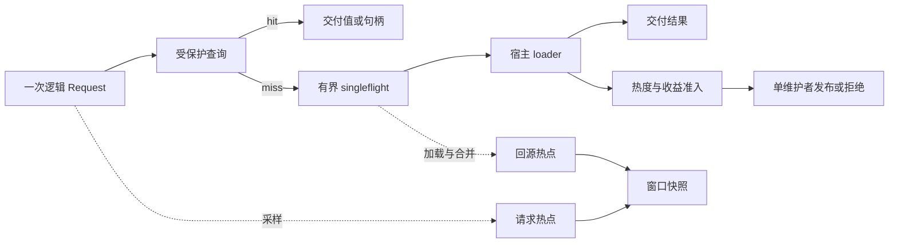
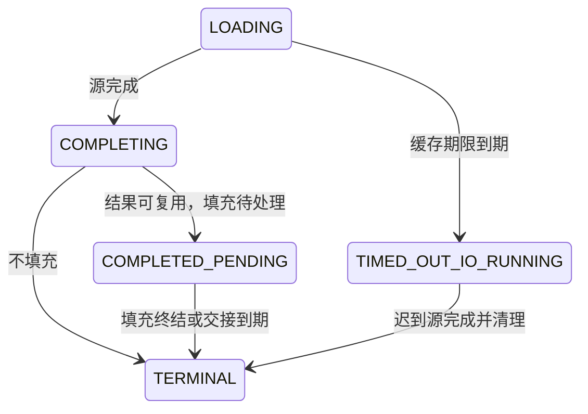

# 架构原理

**中文** | [English](ARCHITECTURE.md)

[使用指南](docs/USAGE.zh.md) · [热点统计](docs/OBSERVABILITY.zh.md) · [源码路线](docs/WALKTHROUGH.zh.md) · [验证与性能](docs/VALIDATION.zh.md)

## 高性能的核心设计

先看这张表，逐项原理见其后各节。请求路径只做四件事：pin 保护槽、探测索引、校验 TTL、更新一次热度字；候选准备、维护与回收都在分片维护者或后台执行器完成。

| 机制 | 做法 | 收益 | 边界与代价 |
| --- | --- | --- | --- |
| 分片 + 单写者 | 带随机种子哈希分片，命名空间参与身份；索引、SIEVE 链、时间轮、账目仅维护者修改 | 读路径不取写锁、不等待维护者，扩展性随分片数增长 | 分片额度与全局空闲池需平衡；`ShardCount` 默认 16、向上取 2 的幂，构造后固定 |
| 固定条目池 + epoch 回收 | 读者 pin epoch 槽，维护者摘链并记退休 epoch，推进两代后归池 | 复用驻留内存，避免 GC 扫描与大堆膨胀 | 保护槽或退休预算不足时返回 `ErrBusy` / `ErrOverloaded` |
| 栈上 `Request` 与借用视图 | `Request` 不逃逸；借用视图 32B、拥有型句柄 48B，`BorrowOn` 复用调用方存储 | 稳态命中 0 B/op、0 allocs/op | 借用视图不可跨作用域；拥有型句柄必须 `Release` |
| 单字原子热度 | `{epoch, current, previous}` 打包进一个 64 位原子字，桶推进与加一一次 CAS 提交 | 计数无锁，不会先公开新桶再清零旧计数 | 12 位计数饱和跳写会低估，门卫碰撞会高估 |
| 有界 `TryLock` + 丢弃计数 | 观测表与条带锁只尝试加锁 | 慢路径与锁竞争不影响交付延迟 | 事件被丢弃，须依靠质量字段辨识 |
| 有界 singleflight + 有界完成泵 | 每身份至多一个真实 loader，loader 在锁外运行，结果经一次性邮箱交给完成泵 | 去重回源、锁持有时间短；队列满仍交付业务结果 | 满队列时只保证交付，不保证填充 |
| 有界淘汰 | 容量足够时不搜索受害者；不足时沿 SIEVE hand 扫描并枚举至多 8 个候选的子集 | 淘汰开销有上界，不做全局搜索 | 不保证全局最优替换 |
| 维护离线化 | 采样条带、sketch 折叠、窗口奇偶双缓冲、按类别配额轮转加软时间预算 | 统计与整理成本不落在请求路径 | 维护滞后会导致缺窗、`Partial` 或 `Skipped` |
| 读时 TTL + 时间轮 | 每次读取用单调时钟校验硬 TTL，后台按预算摘除 | 维护滞后也不会命中过期值 | 约三分之一命中成本是时钟读取；`DisableTicker` 时宿主须驱动 `MaintenanceStep` |

这些机制共同把一次命中压缩成"分片哈希 + 一次索引探测 + 一次时钟读取 + 一次原子计数"。具体基准与压测数值只在[验证与性能](docs/VALIDATION.zh.md)给出，本文不复制，避免把仓库自测当作跨硬件或端到端承诺。

## 数据流

每个 key 按带随机种子的哈希进入一个分片，命名空间参与身份区分。读者访问固定探测索引；每分片只有一个维护者修改索引、SIEVE 链、时间轮和驻留账目。请求路径不等待维护者完成。

缓存与热点统计共用请求入口，统计开关不改变准入和交付语义。`ObserveOnly` 在准备填充候选前直接拒绝驻留，省去条目池及按容量扩大的索引，保留请求热度、可选榜单、加载合并与大小校验。已有业务可只调用 `Get` 记录请求，无需让 SDK 回源。

## 请求热度与收益是两套统计

**热度决定是否够热**。每个热度单元用一个原子字保存当前桶、上一桶与桶号：

`H(t) = current + (1 - φ) × previous`

miss 记入固定大小的 Count-Min 门卫，hit 记入驻留条目。同一 `Request` 只记一次，`Heat` 查询两者之和。碰撞会高估，饱和及有界 CAS 重试会低估。`Tin` 控制进入，`Tout < Tin` 控制退出；新条目有 `Grace` 保护，持续低热度达 `ColdFor` 才冷却摘除。

**收益决定是否值得占用容量**。请求按概率 `SampleP` 进入条带缓冲，维护者把携带原采样概率的样本汇入另一套双桶 sketch。估值分为：

| 状态 | 条件 |
| --- | --- |
| MEASURED | 统计热身完成、有效样本达到 `NMin` |
| PRIOR | 缺少测量时，使用未过期的命名空间先验 |
| UNAVAILABLE | 缺少先验、样本丢失或过旧、模型失效等；暂缓填充 |

预计收益为 `(可避免加载率 × 单次成本 - 持续服务成本) × min(HorizonW, 剩余 TTL)`。默认模型优化命中次数；成本模型需要宿主提供合并率校准，不能把请求率直接当作真实加载率。一次决策冻结时间、先验、模型身份、版本与单位，防止跨模型比较失真。

## 准入与替换

成功加载先交付业务结果，再尝试生成填充候选。候选须满足硬截止时间、代际、热度、大小、交接预算与池槽约束；`ObserveOnly` 在此终止。

容量足够时不搜索受害者。容量不足时沿 SIEVE hand 有界扫描，跳过最近访问过的条目，从最多 8 个候选中枚举可行子集。可行性同时考虑条数、字节、退休预算、索引位置与时间轮。选择损失最小的子集后，扣除安装与移除成本，仅在净收益为正时提交。

这里的“精确”限于已收集的局部候选集；不保证在整个缓存中取得全局最优替换。

候选状态为 `QUEUED → COMMITTING → TERMINAL`。不可逆点之前预留退休责任并复核身份；之后由唯一维护者完成摘除、安装与终态结算，不再调用宿主代码。

## 回源合并与取消

合并身份是 `(命名空间, 完整 key, 命名空间代际, 分片 fillFence)`。条带锁只用有界 `TryLock`，同身份最多一个真实 loader。等待者、真实 I/O、响应字节与执行器任务分别限额。

Flight 的关键状态：

loader 在内部锁之外运行，结果经一次性邮箱交给有界完成泵；队列满时仍能交付业务结果。`COMPLETED_PENDING` 可复用已完成结果，不必重新回源。

取消只结算自己的 Future。缓存加载超时后仍保留真实 I/O 的责任；迟到结果不填充，源真正结束后才归还 I/O 额度。库无法强制停止数据库或 RPC 调用。

## TTL、失效与安全回收

硬 TTL 在每次读取时检查，后台时间轮负责按预算摘除。维护滞后不会让过期值继续命中。冷却扫描与 TTL 摘除独立推进。

单 key 失效由分片维护者确认，推进分片 `fillFence`，使同分片旧令牌的在途填充作废；其他 key 的业务结果仍可交付。命名空间失效先推进代际，旧代际立即逻辑隐藏，再分批摘除。确认仅保证逻辑失效，不等待物理释放。

固定池会复用条目，因此 Go GC 不能代替读者保护：

1. 读者先 pin epoch 保护槽，再读取索引及条目；作用域结束 unpin。
2. 拥有型句柄在 guard 内取得独立 pin，允许跨 goroutine 持有。
3. 维护者先标不可读、摘链并记录退休 epoch。
4. epoch 至少推进两代且拥有型 pin 清空后，执行器释放引用并归还池槽和退休预算。

保护槽、句柄或预算不足返回 `ErrBusy` / `ErrOverloaded`，不通过无界分配绕过限制。返回普通 Go 值后，其保留责任交给调用方；浅拷贝不改变底层存储的共享关系。

## 资源与维护

条数、驻留字节由分片额度和全局空闲池分配，在途转移单独记账：

`Σ 分片额度 + 全局空闲额度 + 在途额度 = 总额度`

交接、响应、退休、加载、等待者和句柄分别预留凭证。每份凭证只能归还或转移一次；预算归还不能早于实际引用释放。`MemoryLimits` 汇总固定结构、有界辅助状态和分类字节额度，依赖 Weigher 与宿主模型的大小契约，不覆盖宿主临时空间、执行器存储、GC 垃圾或 RSS。

维护按类别配额公平轮转，包括样本、控制、填充、时间轮、冷却和退休回收；每轮另有软时间预算。默认 ticker 驱动空闲时的维护。`DisableTicker` 时宿主必须定期调用 `MaintenanceStep`，包括关闭期间。

关闭分三阶段：停止受理 `Shutdown`；等待已受理工作终结 `WaitDrained`；等待读者、句柄、退休和预算清空 `WaitReclaimed`。`Close` 执行停止受理并等待安全回收；上下文到期返回未完成错误，已有清理责任继续保留。

## 热点窗口

### 两张表，两种口径

| 表 | 计数点 | 是否含缓存命中 | 采样 | 开启与读取 |
| --- | --- | --- | --- | --- |
| 请求热点 | 一次成功 `BeginRequest`，`Get` 或 `Fetch` 均计入，不要求 loader | 含，也含仅 `Get` 的流量 | 按 `ObserveRequestSampleP` 采样，默认 1/1024，读数乘 `1/q` | `ObserveRequestKeys > 0` 且须启用历史或通知；只出现在窗口快照 `Requests`，无即时接口 |
| 回源热点 | 真实 loader 调用与合并等待者 | 不含 | 全量事件，无二次采样 | `ObserveHotKeys > 0`；仅统计模式默认每分片 128，负值关闭；即时榜 `HotKeys(n)` 与窗口榜 `Top` |

两张榜不可互相替代：同一 key 同时上榜说明它够热但没被缓存挡住——容量不足、TTL 过短、被淘汰或禁止缓存；只出现在请求榜说明吸收率较高。请求榜用于容量与 key 基数规划，回源榜用于后端压力归因与扩容收益判断。仅统计模式没有 loader，回源榜为空。

两张表都是固定槽位，写入用 `TryLock`，失败只增加丢弃计数；请求不阻塞等待观测锁。

历史窗口与准入热度窗口独立。按奇偶双缓冲归窗，槽满时使用 Space-Saving 继承误差；维护分批收集，发布有界榜单并写入固定历史环。迟到事件不能改写已发布窗口；维护滞后会产生 `Skipped`、`Partial` 或丢失计数。

导出为调用方复制榜单，避免回调或读者污染内部历史。`HotKeyLabel` 在维护线程之外执行；`OnHotWindow` 串行且可能丢通知，推荐只发信号，再用 `HotWindowsSince` 游标读取历史。精度和质量字段见[热点统计](docs/OBSERVABILITY.zh.md)。
